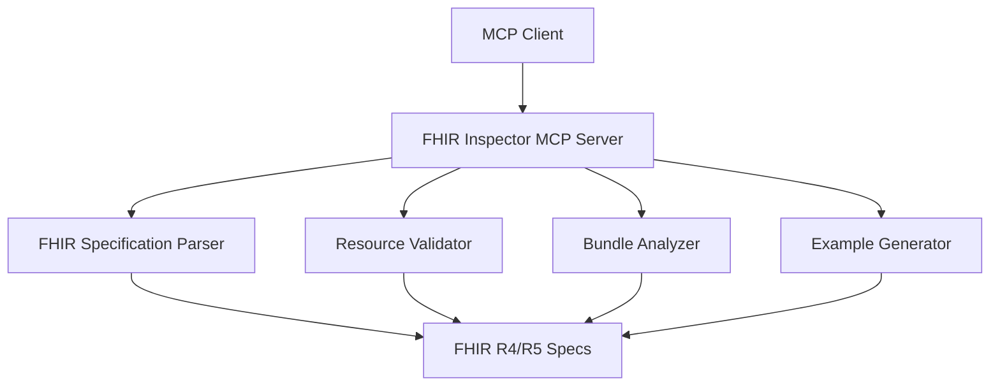

# Architecture Overview

This document provides a high-level overview of the FHIR Inspector MCP architecture.

## System Components



## Core Modules

### 1. FHIR Specification Parser (`fhir_spec_parser.py`)

Parses and caches FHIR R4 and R5 specifications from the official HL7 FHIR specification.

- Downloads and caches structure definitions
- Provides element tree navigation
- Handles inheritance and constraints

### 2. Resource Inspector (`inspect_resource.py`)

Provides structural analysis of FHIR resources.

- Element tree with types and cardinalities
- Reference target resolution
- Binding information extraction

### 3. Resource Validator (`validate_resource.py`)

Validates FHIR resources against profiles.

- Structural validation
- Profile conformance checking
- Detailed error reporting with JSON paths

### 4. Bundle Analyzer (`summarize_bundle.py`)

Analyzes FHIR bundles of all types.

- Entry counting and type distribution
- Reference graph construction
- Pagination metadata extraction

### 5. Example Generator (`generate_example.py`)

Generates valid FHIR resource examples.

- Template-based generation
- Field override support
- Extension inclusion options

## Data Flow

1. **MCP Request** → Server receives tool call
2. **Spec Resolution** → Parser loads FHIR spec if not cached
3. **Tool Execution** → Appropriate module processes request
4. **Response** → Structured JSON returned to client

## Technology Stack

- **Language**: Python 3.11+
- **MCP Framework**: FastMCP
- **FHIR Specs**: HL7 FHIR R4/R5 JSON specifications
- **Validation**: Custom structural validator
- **Packaging**: uv for dependency management

## Deployment

The server runs as a stdio-based MCP server, compatible with any MCP client (Claude Desktop, Cursor, etc.).

```bash
# Direct execution
uvx fhir-inspector-mcp@latest

# Docker
docker run -i ghcr.io/cytocync/fhir-inspector-mcp:latest
```

## Security Considerations

- No external network calls at runtime (specs cached locally)
- No authentication required (stateless)
- Input validation on all tool parameters
- Resource size limits to prevent DoS

## Performance

- Specifications cached in memory after first load
- Lazy loading of spec components
- Typical response time: <100ms for inspection, <500ms for validation

This section provides an overview of the FHIR Inspector MCP architecture.
